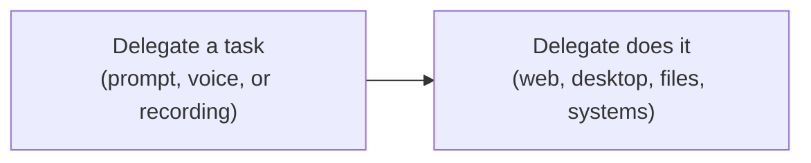

# Prerequisites

Use this checklist to confirm you're ready **before the workshop starts**.

## Your machine

<div class="req-list" markdown>

--8<-- "system-requirements.md"

</div>

The workshop uses Studio, and your machine runs your tests as a robot. Delegate and your robot need an unlocked screen on the day. Turn screen lock back on afterwards.

Pick your operating system. Your choice is remembered on every page.

=== "Windows"

    ??? tip "How to turn off screen lock (Windows 11)"
        1. Open **Start → Settings → System → Power & battery → Screen, sleep, & hibernate timeouts**.
        2. Under **Plugged in**, set **Turn my screen off after** and **Make my device sleep after** to **Never**.

        On a company laptop, a policy may still lock the screen. Check with your IT team.

    !!! warning "Install the latest installer, even if you have Studio"
        Delegate comes with the latest **Short Term Support (STS)** installer. Install it even if you already have Studio. In the installer, select **Studio** and **Assistant, Delegate & Cartographer**.

        For Autopilot in Studio, you need Studio 2026.10 LTS or a current STS (2026.0.199 or later).

    !!! tip "Used Delegate during Preview?"
        Uninstall the Preview build and install the current STS installer. In Delegate, open **Settings → General → About** and check that the version starts with `v26`. See <a href="https://docs.uipath.com/delegate/standalone/latest/user-guide/moving-from-preview-to-ga-installer" target="_blank">Moving from the Preview installer to the GA installer</a>.

=== "macOS"

    !!! info "Preview"
        This is a Public Preview feature. It works for the workshop, but screens may change.

    You need a Mac with Apple silicon (M1 or later), macOS 14 Sonoma or later, and 8 GB of free disk space. Intel Macs aren't supported.

    ✅ **Studio on macOS (Preview)** – install it with the UiPath Platform Installer for macOS (Preview), which also installs Assistant. Use the STS package: `https://download.uipath.com/connected-installer-macos/latest/sts/UiPathPlatformSTS.pkg`. See <a href="https://docs.uipath.com/studio/standalone/latest/user-guide/studio-on-macos" target="_blank">Studio on macOS</a> and <a href="https://docs.uipath.com/uipath-platform-installer/standalone/latest/user-guide/install-on-macos" target="_blank">Install on macOS</a>.

    ✅ **Cross-platform projects only** – Studio on macOS creates and opens only **Cross-platform** projects. You'll pick **Cross-platform** in step 5.

    ✅ **Permissions** – the first time Studio works with the screen, macOS asks for **UiPath UIAutomation** permissions. Allow them in **System Settings → Privacy & Security**, under **Accessibility** and **Screen Recording**.

    ✅ **Delegate for macOS (Preview)** – on an Enterprise STS setup, install it from the DMG (`UiPath Assistant (arm64).dmg`: drag it to **Applications**; it doesn't update itself). On Community, it comes with the platform installer PKG (Preview). See <a href="https://docs.uipath.com/delegate/standalone/latest/user-guide/installation" target="_blank">Install and update</a>. Not yet rehearsed for this workshop. If it doesn't work, skip the Delegate sections below: steps 4, 5 and 8 each have a **No Delegate?** tip that uses a coding agent instead.

    ??? tip "How to keep the screen on (macOS)"
        Open **System Settings → Lock Screen** and set **Turn display off on power adapter when inactive** to **Never**.

        On a company Mac, a policy may still lock the screen. Check with your IT team.

??? tip "No robot on your machine?"
    If your machine can't run the robot, ask your trainer for the **Cloud - Serverless** fallback. Your tests then run in the cloud in steps 7 and 8. It works only with a **Cross-platform** project, which you create in step 5.

## Accounts and access

!!! info "Access is provided by your trainer"
    Your trainer gives you access to the workshop **organization** and **tenant** and guides you through signing in.

    Trainers: see [Trainer Setup](../trainer-setup.md).

Confirm that you can:

✅ Sign in to <a href="https://cloud.uipath.com" target="_blank">UiPath Automation Cloud</a> and open the workshop **organization** and **tenant**

✅ Open **Test Manager** and **Orchestrator** in that tenant

## Orchestrator folder and robot

Signing in to Automation Cloud lets you open Test Manager, but not run tests. Test Manager runs tests through **Orchestrator**, on a **robot**, in a **folder**. Your folder holds:

✅ **Your permissions**, which let you run tests in that folder

✅ **Your machine template**, with a testing runtime, which connects the robot on your machine

??? info "Trainer-led setup: your folder and machine"
    Do this with your trainer, before or at the start of the workshop, as they tell you.

    !!! tip "Orchestrator asks you to choose a layout?"
        Select **New layout** and **Continue**, then close the tour. This guide uses the new layout paths: **Tenant → Infrastructure → Machines**, **Tenant → Access → Access rules** (called *Manage access* in the current (classic) layout) and **Tenant → Access → Folder management** (called *Folders*). For Machines and Folders, see the <a href="https://docs.uipath.com/orchestrator/automation-cloud/latest/user-guide/new-layout-navigation-map" target="_blank">New layout navigation map</a>.

    **Already set up for you?** Your trainer may have created your folder, user settings, machine template and runtime. Then only check that: your folder exists under **Access → Folder management**; your user is listed in its **Manage access** tab; and its **Machines** tab lists your machine template with **1** under **App Testing** or **Testing**. If all three are true, skip to [Connect Studio and Delegate](#connect-studio-and-delegate).

    **1. Machines: allocate a runtime to your machine template**

    1. In Orchestrator, at the **Tenant** level, go to **Infrastructure → Machines**.

        

    2. Search for your machine template by your email. It's named **&lt;your email&gt;'s workspace machine** and is created when you first sign in to UiPath Assistant. Not listed? Ask your trainer. Click the three dots (**⋮**) at the end of its row, and select **Edit Machine**.

        

    3. Under **Runtime licenses**, enter **1** in **App Testing** or **Testing**, whichever you see, and click **Update**.

        { .img-side .img-same-height } { .img-side .img-same-height }

    **2. Access rules: configure your automation capabilities**

    1. At the **Tenant** level, go to **Access → Access rules**, search for your name, click the three dots (**⋮**) at the end of your row, and edit your user.

        

        No **Edit** option for your user? Ask your trainer to do this part for you.

    2. Leave your roles as they are. Your permissions come from a group your trainer sets up.
    3. Expand **Enterprise setup (not recommended for users)**. Under **Enterprise robot setup**, select **Custom Windows credentials**, then fill in:

        === "Windows"

            ✅ **Domain\Username:** open a command prompt, run `whoami`, and enter exactly what it returns.

            ✅ **Password:** your Windows sign-in password. Sign in with a Windows Hello PIN? Set **Credential Type** to **Smart Card** and enter the PIN as the password.

            ✅ No password, or not sure? Tell your trainer before the workshop.

            { width="400" }

            See <a href="https://docs.uipath.com/orchestrator/automation-cloud/latest/user-guide/configuring-automation-capabilities" target="_blank">Configuring automation capabilities</a> (username formats) and <a href="https://docs.uipath.com/robot/standalone/latest/admin-guide/using-entraid-users-with-multifactor-authentication-mfa-with-robots" target="_blank">Using Entra ID users with MFA</a> (Windows Hello PIN).

        === "macOS"

            ✅ **Domain\Username** and **Password:** enter `.\` followed by your Mac account name (for example `.\alexs`), and your Mac password. Run `whoami` in Terminal to see your account name. These turn on **Unattended** for your user. On a Mac, the robot doesn't sign in with them: it runs your tests in your signed-in session.

            ✅ On the day, keep your Mac signed in and unlocked, with Assistant signed in and connected.

            See <a href="https://docs.uipath.com/robot/standalone/latest/admin-guide/mac-unattended-setup" target="_blank">Setting up unattended robots on macOS</a> for a production setup.

    4. Click **Update**.

    !!! tip "Workshop shortcut"
        Your own user runs the tests. In production, an admin assigns a dedicated **robot account** and a machine template to the folder.

    **3. Folder management: create your folder and add your machine template**

    1. In Orchestrator, at the **Tenant** level, go to **Access → Folder management**.

        

    2. Click the new folder icon next to **Manage Folders**.

        { width="400" }

    3. Enter a unique **Name**, such as your own name, keep **Process packages source** as **Tenant package feed**, and click **Create**. This is a standard folder, not your Personal Workspace, which you can't pick as the Default Folder later.

        { width="400" }

    4. Open your folder. In its **Manage access** tab, check that your username is listed as **Folder Administrator**. Not listed? Select **Assign account/group/external app**, add yourself with the **Folder Administrator** role, and click **Assign**. **Robot Type** must show **Attended, Unattended**. **Attended** alone means your credentials from step 2 aren't saved.

        

    5. Open the **Machines** tab, next to **Manage access**. Click **Manage Machines in Folder**, select your machine template, then click **Update** and **Yes** to add it to the folder.

        

    !!! success "Check it"
        In your folder, **Machines** lists your machine template. Scroll the table right: it shows **1** under **App Testing** (Test Cloud) or **Testing** (Automation Cloud). A red **No Unattended Runtimes Assigned** icon is expected for a testing-only template.

    **Check it later:** your robot setup is only proven when Test Manager runs a test on your machine. You do that in [7. Add Test Cases to the Smoke Test Set](../module-2-hands-on-workshop/07-create-test-set.md), once you have an automated, published test case. If the run fails to start or sign in, check the credentials from step 2 (Windows), or that Assistant is signed in and connected with the screen unlocked (macOS).

## Connect Studio and Delegate

**UiPath Delegate** is UiPath's productivity agent, and the evolution of UiPath Assistant. You give it a task, and it completes the task end to end on your real machine, in your browsers and desktop apps.



For testing, Delegate is fully integrated with **Test Manager**, so you can hand it testing work across the whole cycle, from planning and authoring tests to running them and reporting on the results.

On a Mac without Delegate? Do steps 1–2 only, and skip the Delegate checks below and **Set up Delegate**.

1. Launch Studio and **sign in** to the workshop organization and tenant.
2. Open **UiPath Assistant**, click the person icon or your initials (top right) → **Preferences** → **Orchestrator connection**, sign in with your UiPath account, and select the workshop tenant.

    ??? tip "Assistant already shows you signed in and connected?"
        1. Click **Sign out**. Your default browser opens and asks if you want to log out. Don't click it.
        2. In that browser, sign in to the workshop tenant.
        3. Go back to Assistant, click **Sign in**, and follow step 2.

3. Select **Delegate** in the top ribbon. It shows only once Assistant is connected.
4. Set the work profile: in Delegate, click your user name (bottom left) → **Settings** → **Behavior preferences**, and select **QA / Testing**.
5. Click **+ New** in the left panel to start your session. Use this one session for the whole workshop.

!!! success "Check it"
    ✅ Studio shows you signed in to the workshop tenant.

    ✅ **Home → New Project** lists **Test Automation**. No Test Automation option? Ask your trainer to check your license.

    ✅ Delegate opens from Assistant's top ribbon, with **QA / Testing** selected in **Behavior preferences**.

    ✅ The UiPath extension is on in the browser profile you'll use for the workshop:

    === "Windows"

        In the browser you'll use (Chrome: `chrome://extensions`, Edge: `edge://extensions`), make sure the UiPath extension is turned on. If you have several Chrome profiles, use one for the workshop.

    === "macOS"

        Use one Chrome profile for the workshop. Open `chrome://extensions` in it and make sure **UiPath Studio Web Automation** is turned on. On a Mac, the extension stays off in a profile until you approve it there, and the robot opens the profile you used last. See <a href="https://docs.uipath.com/studio/standalone/latest/user-guide/chrome-extension-on-mac" target="_blank">Chrome Extension on Mac</a>.

## Set up Delegate

!!! info "Suggested model: Claude Opus"
    Select **Claude Opus** from the model selector next to the chatbox. This guide was built and tested with Claude Opus 5.5 at Medium. Other models work too, but their results may differ from the guide's samples.

    

### Choose how much Delegate does on its own

Select **Adaptive** from the mode selector next to the chatbox (or **Settings → Security**) and turn **Smart approvals** on.

| Approval mode | What Delegate does |
|---|---|
| **Cautious** | Asks before every operation |
| **Adaptive** *(recommended)* | Auto-approves known safe operations, and asks before the rest. **Smart approvals** also approves what Delegate judges safe |
| **Full access** | Never asks – trusted environments only |

Delegate runs and publishes tests through the `uip` CLI, so the CLI must also be signed in to the workshop tenant. You do that in the next check.

### Check the connection

1. Ask Delegate:

    ```text
    List the tenant I am connected to.
    ```

    !!! tip "Delegate asks to approve PowerShell?"
        Delegate runs its UiPath commands (`uip`) in PowerShell, and in **Adaptive** it asks before running any command. Select **Allow Run PowerShell for this session**. This lets Delegate run **any** PowerShell command without asking until the session ends. When there's no command for a task, Delegate uses your mouse and keyboard instead; that's set separately.

        On a Mac, Delegate runs its commands in the shell instead of PowerShell. Approve the shell command the same way.

    Delegate replies with your organization, tenant and user name. If the tenant isn't the workshop tenant, switch it as in the *Assistant already shows you signed in and connected?* tip, and ask again.

2. Ask Delegate:

    ```text
    Run uip login status.
    ```

    If it says you're not signed in, ask Delegate:

    ```text
    Log me in with uip login.
    ```

    Sign in with your workshop account. Don't continue until the login status shows you signed in to the workshop **organization** and **tenant**. Wrong tenant? Ask Delegate: `Log me out with uip logout, then log me in to the workshop tenant with uip login.`

    If a later step says you're not signed in, or shows `401 Unauthorized`, run this check again.

!!! warning "Delegate acts on your behalf"
    It uses your UiPath account and permissions, and every action is logged in your name.

    ✅ Keep screen context on **Default** (the screen icon next to the chatbox), so Delegate sees only the apps attached to the chat.

    ✅ In **Settings → Security → Blocked websites**, quick-add **Banking**, **Payments** and **Password Manager**.

## Set up your coding agent

A **coding agent** helps you *build* the test automation: it checks your project in step 1, writes and fixes the automated test cases in step 6, and runs and triages them in step 8. It uses the `uip` CLI and the UiPath skills. **Autopilot** is UiPath's own coding agent and the default. **Claude Code** is the alternative. See <a href="https://docs.uipath.com/coding-agents/standalone/latest/user-guide/choosing-your-agent" target="_blank">Choosing your agent</a>.

### Install the uip CLI

Windows with Autopilot and Delegate? You can skip this – Delegate's built-in CLI was checked in [Set up Delegate](#set-up-delegate), and Autopilot installs the CLI when you open its panel. You need it for Claude Code. On a Mac, installing it now saves time on the day, even though the Autopilot extension offers to install it.

=== "Windows"

    In PowerShell, run:

    ```powershell
    irm https://download.uipath.com/uipath-cli/install.ps1 | iex
    ```

=== "macOS"

    In Terminal, run:

    ```bash
    curl -fsSL https://download.uipath.com/uipath-cli/install.sh | bash
    ```

The script installs Node.js if it's missing, the `uip` CLI, the UiPath skills for the coding agents it finds, .NET and Python. It's safe to run again. Prefer npm? Run `npm install -g @uipath/cli` (needs Node.js 22 or later). See <a href="https://docs.uipath.com/uipath-cli/standalone/latest/user-guide/installing-uipath-cli" target="_blank">Installing UiPath CLI</a>.

Then open a new terminal and sign in:

```text
uip --help
uip login
uip login status
```

`uip login` opens your browser: sign in and pick the workshop tenant. `uip login status` must show **Logged in**, with the workshop organization and tenant. The sign-in expires within the hour: if a `uip` command later fails with an auth error or `401 Unauthorized`, run `uip login` again.

### Choose your coding agent

=== "Autopilot"

    === "Windows"

        Autopilot is built into Studio 2026.10 LTS and current STS versions (2026.0.199 or later). Open the **Autopilot** panel in Studio. It installs the UiPath skills and offers to install or update the CLI tools: accept. See <a href="https://docs.uipath.com/autopilot/other/latest/user-guide/autopilot-in-studio-desktop" target="_blank">Autopilot in Studio Desktop</a>.

    === "macOS"

        Install <a href="https://code.visualstudio.com/" target="_blank">VS Code</a> 1.120.0 or later, then the **UiPath Autopilot** extension from the VS Code Marketplace. Open your project folder, trust the workspace, and accept the offer to install the CLI. See <a href="https://docs.uipath.com/autopilot/other/latest/user-guide/autopilot-in-vs-code" target="_blank">Autopilot in VS Code</a>.

        If your Studio on macOS (Preview) shows the Autopilot panel, you can use it instead.

        Not yet rehearsed for this workshop – if it doesn't work, use the Claude Code tab.

=== "Claude Code"

    Any coding agent with the UiPath skills works the same way; the commands below are for Claude Code.

    1. Install Claude Code and sign in. See <a href="https://docs.uipath.com/coding-agents/standalone/latest/user-guide/install-and-set-up" target="_blank">Install and set up</a>.
    2. Install the UiPath skills for Claude Code (they install globally):

        ```text
        uip skills install --agent claude
        ```

    3. In a terminal, run `claude` in the folder you'll use for the workshop.

!!! success "Check it"
    Ask your coding agent:

    ```text
    What UiPath skills do you have installed?
    ```

    It lists the UiPath skills, such as `uipath-test` and `uipath-rpa`.

---

[Next → Introduction: Test Cloud & Test Manager](../module-1-introduction/index.md){: .md-button .md-button--primary}
