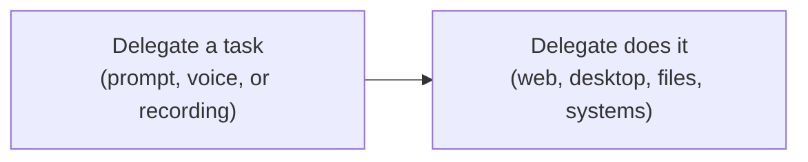

# Prerequisites

Use this checklist to confirm you're ready **before the workshop starts**.

## Your machine

<div class="req-list" markdown>

--8<-- "system-requirements.md"

</div>

The workshop uses Studio Desktop, and your machine runs your tests as a robot. Delegate and your robot need an unlocked screen on the day. Turn screen lock back on afterwards.

??? tip "How to turn off screen lock (Windows 11)"
    1. Open **Start → Settings → System → Power & battery → Screen, sleep, & hibernate timeouts**.
    2. Under **Plugged in**, set **Turn my screen off after** and **Make my device sleep after** to **Never**.

    On a company laptop, a policy may still lock the screen. Check with your IT team.

!!! warning "Install the latest STS version"
    Delegate comes with the latest **Short Term Support (STS)** installer. Install it even if you already have Studio. In the installer, select **Studio** and **Assistant, Delegate & Cartographer**.

## Accounts and access

!!! info "Access is provided by your trainer"
    Your trainer gives you access to the workshop **organization** and **tenant** and guides you through signing in.

    Trainers: see [Trainer Setup](../trainer-setup.md).

Confirm that you can:

✅ Sign in to <a href="https://cloud.uipath.com" target="_blank">UiPath Automation Cloud</a> and open the workshop **organization** and **tenant**

✅ Open **Test Manager** and **Orchestrator** in that tenant

## Orchestrator folder and robot

Signing in to Automation Cloud lets you open Test Manager, but not run tests. Test Manager runs tests through **Orchestrator**, on a **robot**, in a **folder**. Your folder holds:

✅ **Your permissions**, which let you run tests in that folder

✅ **Your machine template**, with a testing runtime, which connects the robot on your laptop


??? info "Trainer-led setup: your folder and machine"
    Do this with your trainer, before or at the start of the workshop, as they tell you.

    **1. Machines: allocate a runtime to your machine template**

    1. In Orchestrator, at the **Tenant** level, go to **Machines**.

        

    2. Search for your machine template by your name, click the three dots (**⋮**) at the end of its row, and select **Edit Machine**.

        

    3. Under **Runtime licenses**, enter **1** in **App Testing** or **Testing**, whichever you see, and click **Update**.

        { .img-side .img-same-height } { .img-side .img-same-height }

    **2. Manage access: configure your automation capabilities**

    1. At the **Tenant** level, go to **Manage access**, search for your name, click the three dots (**⋮**) at the end of your row, and edit your user.

        

    2. Leave your roles as they are. Your permissions come from a group your trainer sets up.
    3. Expand **Enterprise setup (not recommended for users)**. Under **Enterprise robot setup**, select **Custom Windows credentials**, then fill in:

        ✅ **Domain\Username:** open a command prompt, run `whoami`, and enter exactly what it returns.

        ✅ **Password:** your Windows sign-in password. Sign in with a Windows Hello PIN? Set **Credential Type** to **Smart Card** and enter the PIN as the password.

        ✅ No password, or not sure? Tell your trainer before the workshop.

        { width="400" }

        See <a href="https://docs.uipath.com/orchestrator/automation-cloud/latest/user-guide/configuring-automation-capabilities" target="_blank">Configuring automation capabilities</a> (username formats) and <a href="https://docs.uipath.com/robot/standalone/2025.10/admin-guide/using-entraid-users-with-multifactor-authentication-mfa-with-robots" target="_blank">Using Entra ID users with MFA</a> (Windows Hello PIN).

    4. Click **Update**.

    !!! tip "Workshop shortcut"
        Your own user runs the tests. In production, an admin assigns a dedicated **robot account** and a machine template to the folder.

    **3. Folders: create your folder and add your machine template**

    1. In Orchestrator, at the **Tenant** level, go to **Folders**.

        

    2. Click the new folder icon next to **Manage Folders**.

        { width="400" }

    3. Enter a unique **Name**, such as your own name, and click **Create**.

        { width="400" }

    4. Open your folder. In its **Manage access** tab, check that your username is listed, with **Attended, Unattended** under **Robot Type**.

        

    5. Open the **Machines** tab, next to **Manage access**. Click **Manage Machines in Folder**, select your machine template, then click **Update** to add it to the folder.

        

    !!! success "Check it"
        In your folder, **Machines** lists your machine template with **1** under **App Testing** or **Testing**.

    **Check it later:** your robot setup is only proven when Test Manager runs a test on your machine. You do that in [7. Add Test Cases to the Smoke Test Set](../module-2-hands-on-workshop/07-create-test-set.md), once you have an automated, published test case. If the run fails to start or sign in, check the Windows username and password here.

## Connect Studio and Delegate

**UiPath Delegate** is UiPath's productivity agent, and the evolution of UiPath Assistant. You give it a task, and it completes the task end to end on your real machine, in your browsers and desktop apps.



For testing, Delegate is fully integrated with **Test Manager**, so you can hand it testing work across the whole cycle, from planning and authoring tests to running them and reporting on the results.

1. Launch Studio and **sign in** to the workshop organization and tenant.
2. Open **UiPath Assistant**, click the person icon or your initials (top right) → **Preferences** → **Orchestrator connection**, sign in with your UiPath account, and select the workshop tenant.

    ??? tip "Assistant already shows you signed in and connected?"
        1. Click **Sign out**. Your default browser opens and asks if you want to log out. Don't click it.
        2. In that browser, sign in to the workshop tenant.
        3. Go back to Assistant, click **Sign in**, and follow step 2.

3. Select **Delegate** in the top ribbon. It shows only once Assistant is connected.
4. Set the work profile: in Delegate, click your user name (bottom left) → **Settings** → **Behavior preferences**, and select **QA / Testing**.
5. Click **+ New** in the left panel to start your session. Use this one session for the whole workshop.

!!! success "Check it"
    ✅ Studio shows you signed in to the workshop tenant.

    ✅ **Home → New Project** lists **Test Automation**. No Test Automation option? Ask your trainer to check your license.

    ✅ The UiPath extension is enabled in your browser.

    ✅ Delegate opens from Assistant's top ribbon, with **QA / Testing** selected in **Behavior preferences**.

## Set up Delegate

### Choose how much Delegate does on its own

Select **Adaptive** from the mode selector next to the chatbox (or **Settings → Security**) and turn **Smart approvals** on.

| Approval mode | What Delegate does |
|---|---|
| **Cautious** | Asks before every operation |
| **Adaptive** *(recommended)* | Auto-approves known safe operations, and asks before the rest. **Smart approvals** also approves what Delegate judges safe |
| **Full access** | Never asks — trusted environments only |

### Check the connection

1. Ask Delegate:

    ```text
    List the tenant I am connected to.
    ```

    !!! tip "Delegate asks to approve PowerShell?"
        Running PowerShell is a high-risk tool, so Delegate asks even in **Adaptive**. Select **Allow Run PowerShell for this session**. Delegate then runs PowerShell without asking for the rest of your session.

    Delegate replies with your organization, tenant and user name. If the tenant isn't the workshop tenant, switch it as in the *Assistant already shows you signed in and connected?* tip, and ask again.

2. Ask Delegate:

    ```text
    Run uip login status.
    ```

    If it says you're not signed in, ask Delegate:

    ```text
    Log me in with uip login.
    ```

    Sign in with your workshop account. Don't continue until the login status comes back clean.

!!! warning "Delegate acts on your behalf"
    It uses your UiPath account and permissions, and every action is logged in your name.

    ✅ Keep screen context on **Default** (the screen icon next to the chatbox), so Delegate sees only the apps attached to the chat.

    ✅ In **Settings → Security → Blocked websites**, quick-add **Banking**, **Payments** and **Password Manager**.

---

[Next → Introduction: Test Cloud & Test Manager](../module-1-introduction/index.md){: .md-button .md-button--primary}
